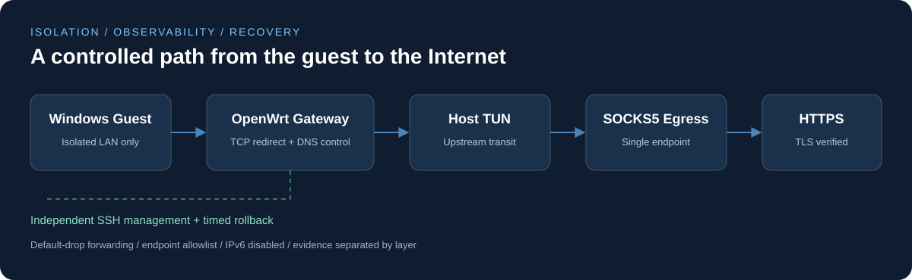

<div align="center">

# Isolated VM Network Lab

### 隔离虚拟机网络实验与可验证出口控制

**Network Isolation · Layered Diagnostics · Fail-Closed Egress · Recoverable Changes**

基于 Windows、VMware、OpenWrt 与 Mihomo 的网络工程实践。

</div>

## 项目概述

本项目面向需要独立网络环境的桌面虚拟机，构建“隔离客机—专用网关—上游中转—固定出口”的分层网络架构。项目重点是将网络可用性与出口约束转化为可观察、可复核、可恢复的工程流程：**既能解释流量从哪里经过，也能在代理失效时阻止客机直接访问公网。**

公开仓库保留核心源代码、去标识化配置模板、诊断工具和实验方法；实际账号、供应商入口、个人设备信息与原始运行记录均不包含在内。



## 核心工作

| 方向 | 实现与方法 | 工程意义 |
|---|---|---|
| 网络隔离 | Windows 客机仅连接专用 LAN，OpenWrt 双网卡分别承担客机接入与 NAT 管理 | 将业务网络与管理路径分离 |
| 出口控制 | TCP 透明重定向、DNS 接管、IPv6 禁用、不支持 UDP 的阻断、唯一入口白名单 | 代理异常时保持失败关闭 |
| 分层诊断 | 分别观察本地代理、SOCKS5 协商、认证、目标连接、TLS 与 HTTP | 避免将所有故障归因于应用或网关 |
| 安全变更 | 原值备份、配置校验、独立倒计时回滚、验收后解除回滚 | 提高修改可恢复性 |
| 客机验证 | C# 只读检查工具，覆盖 HTTPS、DNS、IPv6、UDP 与不依赖 DNS 的 HTTPS | 将网关结果与客机结果分开核验 |
| 隐私发布 | 文件白名单、示例地址、脱敏结果摘要、逐文件校验清单 | 使项目可以公开审阅与复核 |

## 代表性问题与解决过程

### 1. 客机未接入网络与上游不可达同时存在

排查最初发现，虚拟网卡未连接，网关没有客机租约与请求。修复客机接入后，上游超时仍然存在。进一步绕过网关、在宿主重复相同代理路径，复现了 SOCKS5 握手超时，从而将故障范围缩小到上游入口或特定连接路径。

### 2. 用同路径对照区分供应商入口问题

在同一个上游中转节点下，同时测试两个出口。出口 A 两次在 SOCKS5 方法协商阶段约 12 秒超时；出口 B 三次完成认证与 HTTPS 访问。该结果支持替换当前故障入口，但不能外推为供应商整体质量结论。详见 [实验记录](docs/experiments.md)。

### 3. 防火墙刷新遗留旧入口

替换出口后，验收发现 `flush table` 未清空命名集合中的旧元素。修复为在单个 nftables 事务内删除并重建受管表，重新验收唯一入口集合，避免“代理已切换，旧入口仍放行”的状态残留。

## 验证结果与证据边界

| 检查项 | 结果 | 证据来源 |
|---|---|---|
| 新出口 HTTPS、DNS A、IPv4 出口比较 | 通过 | 网关工具实测 |
| 唯一入口允许集合、output / forward 默认丢弃 | 通过 | 网关规则实测 |
| 客机 HTTPS 与 DNS A | 通过 | 使用者运行检测工具后回传 |
| 客机 DNS AAAA、IPv6 TCP | 无回答 / 不可达 | 使用者回传 |
| 客机 STUN UDP | 无响应；结合网关阻断规则解读 | 使用者回传与规则检查 |
| 目标桌面应用收发消息 | 使用者确认正常 | 人工功能验证 |
| 浏览器 WebRTC 无泄露 | **尚未独立确认** | “功能开启”不足以形成泄露结论 |
| 新出口完整冷启动恢复与故障演练 | **待补验** | 旧配置曾完成演练，不作为新配置验收 |

以上为 2026 年 10 月的单环境工程记录，不是持续在线状态、性能基准或普适安全认证。

## 仓库导航

- [架构与流量边界](docs/architecture.md)：拓扑、规则语义与信任边界。
- [实验与故障归因](docs/experiments.md)：对照设计、观察结果及解释范围。
- [部署与验证](docs/deployment.md)：依赖、构建、操作前提和验收步骤。
- [隐私与公开内容边界](PRIVACY.md)：公开材料的筛选与脱敏方式。
- `gateway/`：nftables 模板、防护服务与 IPv6 热插拔规则。
- `tools/`：客机检测、ISO 构建、SOCKS5 分段诊断与出口切换工具。
- `tests/`：离线协议测试及公开包检查；不会访问实际供应商。

## 快速开始

离线校验需要 Python 3.10+，实际在 Python 3.12 上验证：

```sh
python -B -m unittest discover -s tests -v
python -B tools/privacy_check.py
python -B tools/verify_manifest.py
```

这些命令不会部署网关或发起公网探测。网络测试与实际部署请先阅读[操作说明](docs/deployment.md)。

## 实施范围

原环境使用 Windows 宿主、VMware Workstation、OpenWrt 24.10.8 与 Mihomo 1.19.32。公开配置中的地址和拓扑为示例，工具面向受控实验环境，需结合自己的接口、管理地址、路由与控制台恢复入口配置。

项目采用工具辅助开发与人工验收。公开快照为可审阅的工程材料，不附带虚拟机镜像、第三方二进制、代理订阅或账户资源。
